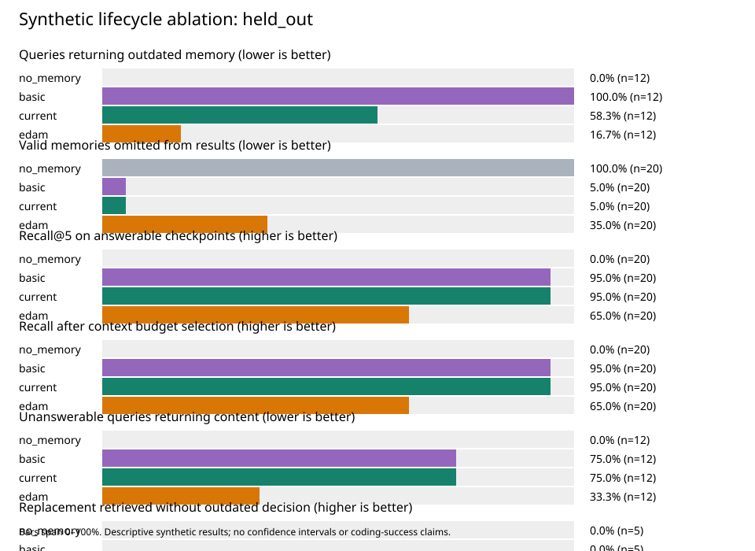

# Synthetic commit-aware retrieval experiment

Mode: **keyword_file_proxy**. Dataset SHA-256: `87115033b50a7a42c4f61d81ddfd68e0417e9d85814a8721d19f33d2a6a60794`.

All four conditions use the same corpus, query, file hints, and task. This keyword/file-proxy run uses no vector embeddings.
`no_memory` returns no memories; `basic` disables lifecycle filtering; `current` uses lifecycle-aware baseline ranking; `edam` adds evidence-aware scoring, abstention, and adaptive context packing.

| Partition/category | Variant | Checkpoints | Recall@k | Budgeted recall | MRR | Outdated hit | Outdated rate | Valid suppression | No-answer FP | Update correct | Evidence state correct |
| --- | --- | ---: | ---: | ---: | ---: | ---: | ---: | ---: | ---: | ---: | ---: |
| held_out/all | no_memory | 32 | 0.000 | 0.000 | 0.000 | 0.000 | 0.000 | 1.000 | 0.000 | 0.000 | 1.000 |
| held_out/all | basic | 32 | 0.950 | 0.950 | 0.950 | 1.000 | 1.000 | 0.050 | 0.750 | 0.000 | 1.000 |
| held_out/all | current | 32 | 0.950 | 0.950 | 0.950 | 0.583 | 0.583 | 0.050 | 0.750 | 1.000 | 1.000 |
| held_out/all | edam | 32 | 0.650 | 0.650 | 0.650 | 0.167 | 0.167 | 0.350 | 0.333 | 1.000 | 1.000 |
| held_out/ambiguous | no_memory | 1 | N/A | N/A | N/A | N/A | N/A | N/A | 0.000 | N/A | 1.000 |
| held_out/ambiguous | basic | 1 | N/A | N/A | N/A | N/A | N/A | N/A | 1.000 | N/A | 1.000 |
| held_out/ambiguous | current | 1 | N/A | N/A | N/A | N/A | N/A | N/A | 1.000 | N/A | 1.000 |
| held_out/ambiguous | edam | 1 | N/A | N/A | N/A | N/A | N/A | N/A | 1.000 | N/A | 1.000 |
| held_out/changed | no_memory | 7 | N/A | N/A | N/A | 0.000 | 0.000 | N/A | 0.000 | N/A | N/A |
| held_out/changed | basic | 7 | N/A | N/A | N/A | 1.000 | 1.000 | N/A | 1.000 | N/A | N/A |
| held_out/changed | current | 7 | N/A | N/A | N/A | 1.000 | 1.000 | N/A | 1.000 | N/A | N/A |
| held_out/changed | edam | 7 | N/A | N/A | N/A | 0.286 | 0.286 | N/A | 0.286 | N/A | N/A |
| held_out/evidence_missing | no_memory | 1 | N/A | N/A | N/A | N/A | N/A | N/A | 0.000 | N/A | 1.000 |
| held_out/evidence_missing | basic | 1 | N/A | N/A | N/A | N/A | N/A | N/A | 1.000 | N/A | 1.000 |
| held_out/evidence_missing | current | 1 | N/A | N/A | N/A | N/A | N/A | N/A | 1.000 | N/A | 1.000 |
| held_out/evidence_missing | edam | 1 | N/A | N/A | N/A | N/A | N/A | N/A | 1.000 | N/A | 1.000 |
| held_out/no_answer | no_memory | 3 | N/A | N/A | N/A | N/A | N/A | N/A | 0.000 | N/A | N/A |
| held_out/no_answer | basic | 3 | N/A | N/A | N/A | N/A | N/A | N/A | 0.000 | N/A | N/A |
| held_out/no_answer | current | 3 | N/A | N/A | N/A | N/A | N/A | N/A | 0.000 | N/A | N/A |
| held_out/no_answer | edam | 3 | N/A | N/A | N/A | N/A | N/A | N/A | 0.000 | N/A | N/A |
| held_out/superseded | no_memory | 5 | 0.000 | 0.000 | 0.000 | 0.000 | 0.000 | 1.000 | N/A | 0.000 | N/A |
| held_out/superseded | basic | 5 | 1.000 | 1.000 | 1.000 | 1.000 | 1.000 | 0.000 | N/A | 0.000 | N/A |
| held_out/superseded | current | 5 | 1.000 | 1.000 | 1.000 | 0.000 | 0.000 | 0.000 | N/A | 1.000 | N/A |
| held_out/superseded | edam | 5 | 1.000 | 1.000 | 1.000 | 0.000 | 0.000 | 0.000 | N/A | 1.000 | N/A |
| held_out/unrelated | no_memory | 5 | 0.000 | 0.000 | 0.000 | N/A | N/A | 1.000 | N/A | N/A | N/A |
| held_out/unrelated | basic | 5 | 0.800 | 0.800 | 0.800 | N/A | N/A | 0.200 | N/A | N/A | N/A |
| held_out/unrelated | current | 5 | 0.800 | 0.800 | 0.800 | N/A | N/A | 0.200 | N/A | N/A | N/A |
| held_out/unrelated | edam | 5 | 0.400 | 0.400 | 0.400 | N/A | N/A | 0.600 | N/A | N/A | N/A |
| held_out/valid | no_memory | 10 | 0.000 | 0.000 | 0.000 | N/A | N/A | 1.000 | N/A | N/A | N/A |
| held_out/valid | basic | 10 | 1.000 | 1.000 | 1.000 | N/A | N/A | 0.000 | N/A | N/A | N/A |
| held_out/valid | current | 10 | 1.000 | 1.000 | 1.000 | N/A | N/A | 0.000 | N/A | N/A | N/A |
| held_out/valid | edam | 10 | 0.600 | 0.600 | 0.600 | N/A | N/A | 0.400 | N/A | N/A | N/A |

## Interpretation and limitations

- Outdated means factually replaced according to fixture labels. Stale means unreviewed evidence; these differ.
- Valid-refactor scenarios have two checkpoints. Pending-review recall measures the cost of withholding a still-true memory; after-review measures recovery.
- Missing-answer cases include changed facts whose replacements have not been recorded and four unrelated questions. Category rows separate them.
- The basic/current comparison isolates lifecycle filtering; EDAM additionally uses the relevance gate, evidence state, conflict handling, and adaptive budget packing.
- Denominators are stored beside every aggregate in summary.csv; N/A values are excluded, never counted as zero.
- Labels and review actions are authored fixtures, not automated truth verification or LLM extraction.
- Seven development scenarios and 27 reserved scenarios were fixed before execution. This is not an independently authored, blinded, or real-world benchmark.
- Scenarios use small Python configuration files and six shared distractors. Category samples are small and templated; no significance or generalization claim is justified.
- No model answers or agent coding success is measured here. Use the separate four-condition coding-task runner for paired coding tasks and test outcomes.
- Raw results preserve IDs, statuses, relevance labels, ranking reasons/scores, actual commits, diffs, and lifecycle events.

## Observed failures / tradeoffs

- no_memory: 20 checkpoints with at least one measured failure/tradeoff.
  - `s10-passwords/after_observation`: `{"budgeted_recall": 0.0, "evidence_state_correct": null, "ineligible_hit": null, "no_answer_false_positive": null, "outdated_fraction": 0.0, "outdated_hit": null, "outdated_memory_retrieval_rate": null, "recall_at_k": 0.0, "reciprocal_rank": 0.0, "update_correct": null, "valid_memory_suppression_rate": 1.0}`
  - `s11-exports/after_observation`: `{"budgeted_recall": 0.0, "evidence_state_correct": null, "ineligible_hit": null, "no_answer_false_positive": null, "outdated_fraction": 0.0, "outdated_hit": null, "outdated_memory_retrieval_rate": null, "recall_at_k": 0.0, "reciprocal_rank": 0.0, "update_correct": null, "valid_memory_suppression_rate": 1.0}`
  - `s12-images/after_observation`: `{"budgeted_recall": 0.0, "evidence_state_correct": null, "ineligible_hit": null, "no_answer_false_positive": null, "outdated_fraction": 0.0, "outdated_hit": null, "outdated_memory_retrieval_rate": null, "recall_at_k": 0.0, "reciprocal_rank": 0.0, "update_correct": null, "valid_memory_suppression_rate": 1.0}`
  - `s13-sessions/after_observation`: `{"budgeted_recall": 0.0, "evidence_state_correct": null, "ineligible_hit": null, "no_answer_false_positive": null, "outdated_fraction": 0.0, "outdated_hit": null, "outdated_memory_retrieval_rate": null, "recall_at_k": 0.0, "reciprocal_rank": 0.0, "update_correct": null, "valid_memory_suppression_rate": 1.0}`
  - `s14-reports/after_observation`: `{"budgeted_recall": 0.0, "evidence_state_correct": null, "ineligible_hit": null, "no_answer_false_positive": null, "outdated_fraction": 0.0, "outdated_hit": null, "outdated_memory_retrieval_rate": null, "recall_at_k": 0.0, "reciprocal_rank": 0.0, "update_correct": null, "valid_memory_suppression_rate": 1.0}`
  - `s16-transport/pending_review`: `{"budgeted_recall": 0.0, "evidence_state_correct": null, "ineligible_hit": false, "no_answer_false_positive": null, "outdated_fraction": 0.0, "outdated_hit": null, "outdated_memory_retrieval_rate": null, "recall_at_k": 0.0, "reciprocal_rank": 0.0, "update_correct": null, "valid_memory_suppression_rate": 1.0}`
  - `s16-transport/after_review`: `{"budgeted_recall": 0.0, "evidence_state_correct": null, "ineligible_hit": false, "no_answer_false_positive": null, "outdated_fraction": 0.0, "outdated_hit": null, "outdated_memory_retrieval_rate": null, "recall_at_k": 0.0, "reciprocal_rank": 0.0, "update_correct": null, "valid_memory_suppression_rate": 1.0}`
  - `s17-audit/pending_review`: `{"budgeted_recall": 0.0, "evidence_state_correct": null, "ineligible_hit": false, "no_answer_false_positive": null, "outdated_fraction": 0.0, "outdated_hit": null, "outdated_memory_retrieval_rate": null, "recall_at_k": 0.0, "reciprocal_rank": 0.0, "update_correct": null, "valid_memory_suppression_rate": 1.0}`
  - `s17-audit/after_review`: `{"budgeted_recall": 0.0, "evidence_state_correct": null, "ineligible_hit": false, "no_answer_false_positive": null, "outdated_fraction": 0.0, "outdated_hit": null, "outdated_memory_retrieval_rate": null, "recall_at_k": 0.0, "reciprocal_rank": 0.0, "update_correct": null, "valid_memory_suppression_rate": 1.0}`
  - `s18-inventory/pending_review`: `{"budgeted_recall": 0.0, "evidence_state_correct": null, "ineligible_hit": false, "no_answer_false_positive": null, "outdated_fraction": 0.0, "outdated_hit": null, "outdated_memory_retrieval_rate": null, "recall_at_k": 0.0, "reciprocal_rank": 0.0, "update_correct": null, "valid_memory_suppression_rate": 1.0}`
  - `s18-inventory/after_review`: `{"budgeted_recall": 0.0, "evidence_state_correct": null, "ineligible_hit": false, "no_answer_false_positive": null, "outdated_fraction": 0.0, "outdated_hit": null, "outdated_memory_retrieval_rate": null, "recall_at_k": 0.0, "reciprocal_rank": 0.0, "update_correct": null, "valid_memory_suppression_rate": 1.0}`
  - `s19-email/pending_review`: `{"budgeted_recall": 0.0, "evidence_state_correct": null, "ineligible_hit": false, "no_answer_false_positive": null, "outdated_fraction": 0.0, "outdated_hit": null, "outdated_memory_retrieval_rate": null, "recall_at_k": 0.0, "reciprocal_rank": 0.0, "update_correct": null, "valid_memory_suppression_rate": 1.0}`
  - `s19-email/after_review`: `{"budgeted_recall": 0.0, "evidence_state_correct": null, "ineligible_hit": false, "no_answer_false_positive": null, "outdated_fraction": 0.0, "outdated_hit": null, "outdated_memory_retrieval_rate": null, "recall_at_k": 0.0, "reciprocal_rank": 0.0, "update_correct": null, "valid_memory_suppression_rate": 1.0}`
  - `s20-money/pending_review`: `{"budgeted_recall": 0.0, "evidence_state_correct": null, "ineligible_hit": false, "no_answer_false_positive": null, "outdated_fraction": 0.0, "outdated_hit": null, "outdated_memory_retrieval_rate": null, "recall_at_k": 0.0, "reciprocal_rank": 0.0, "update_correct": null, "valid_memory_suppression_rate": 1.0}`
  - `s20-money/after_review`: `{"budgeted_recall": 0.0, "evidence_state_correct": null, "ineligible_hit": false, "no_answer_false_positive": null, "outdated_fraction": 0.0, "outdated_hit": null, "outdated_memory_retrieval_rate": null, "recall_at_k": 0.0, "reciprocal_rank": 0.0, "update_correct": null, "valid_memory_suppression_rate": 1.0}`
  - `s22-logs/after_review`: `{"budgeted_recall": 0.0, "evidence_state_correct": null, "ineligible_hit": false, "no_answer_false_positive": null, "outdated_fraction": 0.0, "outdated_hit": false, "outdated_memory_retrieval_rate": 0.0, "recall_at_k": 0.0, "reciprocal_rank": 0.0, "update_correct": false, "valid_memory_suppression_rate": 1.0}`
  - `s23-pagination/after_review`: `{"budgeted_recall": 0.0, "evidence_state_correct": null, "ineligible_hit": false, "no_answer_false_positive": null, "outdated_fraction": 0.0, "outdated_hit": false, "outdated_memory_retrieval_rate": 0.0, "recall_at_k": 0.0, "reciprocal_rank": 0.0, "update_correct": false, "valid_memory_suppression_rate": 1.0}`
  - `s24-notifications/after_review`: `{"budgeted_recall": 0.0, "evidence_state_correct": null, "ineligible_hit": false, "no_answer_false_positive": null, "outdated_fraction": 0.0, "outdated_hit": false, "outdated_memory_retrieval_rate": 0.0, "recall_at_k": 0.0, "reciprocal_rank": 0.0, "update_correct": false, "valid_memory_suppression_rate": 1.0}`
  - `s25-backups/after_review`: `{"budgeted_recall": 0.0, "evidence_state_correct": null, "ineligible_hit": false, "no_answer_false_positive": null, "outdated_fraction": 0.0, "outdated_hit": false, "outdated_memory_retrieval_rate": 0.0, "recall_at_k": 0.0, "reciprocal_rank": 0.0, "update_correct": false, "valid_memory_suppression_rate": 1.0}`
  - `s26-compression/after_review`: `{"budgeted_recall": 0.0, "evidence_state_correct": null, "ineligible_hit": false, "no_answer_false_positive": null, "outdated_fraction": 0.0, "outdated_hit": false, "outdated_memory_retrieval_rate": 0.0, "recall_at_k": 0.0, "reciprocal_rank": 0.0, "update_correct": false, "valid_memory_suppression_rate": 1.0}`
- basic: 15 checkpoints with at least one measured failure/tradeoff.
  - `s02-cache/after_observation`: `{"budgeted_recall": null, "evidence_state_correct": null, "ineligible_hit": true, "no_answer_false_positive": true, "outdated_fraction": 1.0, "outdated_hit": true, "outdated_memory_retrieval_rate": 1.0, "recall_at_k": null, "reciprocal_rank": null, "update_correct": null, "valid_memory_suppression_rate": null}`
  - `s03-auth/after_observation`: `{"budgeted_recall": null, "evidence_state_correct": null, "ineligible_hit": true, "no_answer_false_positive": true, "outdated_fraction": 1.0, "outdated_hit": true, "outdated_memory_retrieval_rate": 1.0, "recall_at_k": null, "reciprocal_rank": null, "update_correct": null, "valid_memory_suppression_rate": null}`
  - `s04-uploads/after_observation`: `{"budgeted_recall": null, "evidence_state_correct": null, "ineligible_hit": true, "no_answer_false_positive": true, "outdated_fraction": 1.0, "outdated_hit": true, "outdated_memory_retrieval_rate": 1.0, "recall_at_k": null, "reciprocal_rank": null, "update_correct": null, "valid_memory_suppression_rate": null}`
  - `s05-retry/after_observation`: `{"budgeted_recall": null, "evidence_state_correct": null, "ineligible_hit": true, "no_answer_false_positive": true, "outdated_fraction": 1.0, "outdated_hit": true, "outdated_memory_retrieval_rate": 1.0, "recall_at_k": null, "reciprocal_rank": null, "update_correct": null, "valid_memory_suppression_rate": null}`
  - `s06-dates/after_observation`: `{"budgeted_recall": null, "evidence_state_correct": null, "ineligible_hit": true, "no_answer_false_positive": true, "outdated_fraction": 1.0, "outdated_hit": true, "outdated_memory_retrieval_rate": 1.0, "recall_at_k": null, "reciprocal_rank": null, "update_correct": null, "valid_memory_suppression_rate": null}`
  - `s07-queue/after_observation`: `{"budgeted_recall": null, "evidence_state_correct": null, "ineligible_hit": true, "no_answer_false_positive": true, "outdated_fraction": 1.0, "outdated_hit": true, "outdated_memory_retrieval_rate": 1.0, "recall_at_k": null, "reciprocal_rank": null, "update_correct": null, "valid_memory_suppression_rate": null}`
  - `s08-search/after_observation`: `{"budgeted_recall": null, "evidence_state_correct": null, "ineligible_hit": true, "no_answer_false_positive": true, "outdated_fraction": 1.0, "outdated_hit": true, "outdated_memory_retrieval_rate": 1.0, "recall_at_k": null, "reciprocal_rank": null, "update_correct": null, "valid_memory_suppression_rate": null}`
  - `s13-sessions/after_observation`: `{"budgeted_recall": 0.0, "evidence_state_correct": null, "ineligible_hit": null, "no_answer_false_positive": null, "outdated_fraction": 0.0, "outdated_hit": null, "outdated_memory_retrieval_rate": null, "recall_at_k": 0.0, "reciprocal_rank": 0.0, "update_correct": null, "valid_memory_suppression_rate": 1.0}`
  - `s22-logs/after_review`: `{"budgeted_recall": 1.0, "evidence_state_correct": null, "ineligible_hit": true, "no_answer_false_positive": null, "outdated_fraction": 0.5, "outdated_hit": true, "outdated_memory_retrieval_rate": 1.0, "recall_at_k": 1.0, "reciprocal_rank": 1.0, "update_correct": false, "valid_memory_suppression_rate": 0.0}`
  - `s23-pagination/after_review`: `{"budgeted_recall": 1.0, "evidence_state_correct": null, "ineligible_hit": true, "no_answer_false_positive": null, "outdated_fraction": 0.5, "outdated_hit": true, "outdated_memory_retrieval_rate": 1.0, "recall_at_k": 1.0, "reciprocal_rank": 1.0, "update_correct": false, "valid_memory_suppression_rate": 0.0}`
  - `s24-notifications/after_review`: `{"budgeted_recall": 1.0, "evidence_state_correct": null, "ineligible_hit": true, "no_answer_false_positive": null, "outdated_fraction": 0.5, "outdated_hit": true, "outdated_memory_retrieval_rate": 1.0, "recall_at_k": 1.0, "reciprocal_rank": 1.0, "update_correct": false, "valid_memory_suppression_rate": 0.0}`
  - `s25-backups/after_review`: `{"budgeted_recall": 1.0, "evidence_state_correct": null, "ineligible_hit": true, "no_answer_false_positive": null, "outdated_fraction": 0.3333333333333333, "outdated_hit": true, "outdated_memory_retrieval_rate": 1.0, "recall_at_k": 1.0, "reciprocal_rank": 1.0, "update_correct": false, "valid_memory_suppression_rate": 0.0}`
  - `s26-compression/after_review`: `{"budgeted_recall": 1.0, "evidence_state_correct": null, "ineligible_hit": true, "no_answer_false_positive": null, "outdated_fraction": 0.5, "outdated_hit": true, "outdated_memory_retrieval_rate": 1.0, "recall_at_k": 1.0, "reciprocal_rank": 1.0, "update_correct": false, "valid_memory_suppression_rate": 0.0}`
  - `s32-retired_auth/after_observation`: `{"budgeted_recall": null, "evidence_state_correct": true, "ineligible_hit": true, "no_answer_false_positive": true, "outdated_fraction": 0.0, "outdated_hit": null, "outdated_memory_retrieval_rate": null, "recall_at_k": null, "reciprocal_rank": null, "update_correct": null, "valid_memory_suppression_rate": null}`
  - `s34-runtime_auth/after_observation`: `{"budgeted_recall": null, "evidence_state_correct": true, "ineligible_hit": true, "no_answer_false_positive": true, "outdated_fraction": 0.0, "outdated_hit": null, "outdated_memory_retrieval_rate": null, "recall_at_k": null, "reciprocal_rank": null, "update_correct": null, "valid_memory_suppression_rate": null}`
- current: 10 checkpoints with at least one measured failure/tradeoff.
  - `s02-cache/after_observation`: `{"budgeted_recall": null, "evidence_state_correct": null, "ineligible_hit": true, "no_answer_false_positive": true, "outdated_fraction": 1.0, "outdated_hit": true, "outdated_memory_retrieval_rate": 1.0, "recall_at_k": null, "reciprocal_rank": null, "update_correct": null, "valid_memory_suppression_rate": null}`
  - `s03-auth/after_observation`: `{"budgeted_recall": null, "evidence_state_correct": null, "ineligible_hit": true, "no_answer_false_positive": true, "outdated_fraction": 1.0, "outdated_hit": true, "outdated_memory_retrieval_rate": 1.0, "recall_at_k": null, "reciprocal_rank": null, "update_correct": null, "valid_memory_suppression_rate": null}`
  - `s04-uploads/after_observation`: `{"budgeted_recall": null, "evidence_state_correct": null, "ineligible_hit": true, "no_answer_false_positive": true, "outdated_fraction": 1.0, "outdated_hit": true, "outdated_memory_retrieval_rate": 1.0, "recall_at_k": null, "reciprocal_rank": null, "update_correct": null, "valid_memory_suppression_rate": null}`
  - `s05-retry/after_observation`: `{"budgeted_recall": null, "evidence_state_correct": null, "ineligible_hit": true, "no_answer_false_positive": true, "outdated_fraction": 1.0, "outdated_hit": true, "outdated_memory_retrieval_rate": 1.0, "recall_at_k": null, "reciprocal_rank": null, "update_correct": null, "valid_memory_suppression_rate": null}`
  - `s06-dates/after_observation`: `{"budgeted_recall": null, "evidence_state_correct": null, "ineligible_hit": true, "no_answer_false_positive": true, "outdated_fraction": 1.0, "outdated_hit": true, "outdated_memory_retrieval_rate": 1.0, "recall_at_k": null, "reciprocal_rank": null, "update_correct": null, "valid_memory_suppression_rate": null}`
  - `s07-queue/after_observation`: `{"budgeted_recall": null, "evidence_state_correct": null, "ineligible_hit": true, "no_answer_false_positive": true, "outdated_fraction": 1.0, "outdated_hit": true, "outdated_memory_retrieval_rate": 1.0, "recall_at_k": null, "reciprocal_rank": null, "update_correct": null, "valid_memory_suppression_rate": null}`
  - `s08-search/after_observation`: `{"budgeted_recall": null, "evidence_state_correct": null, "ineligible_hit": true, "no_answer_false_positive": true, "outdated_fraction": 1.0, "outdated_hit": true, "outdated_memory_retrieval_rate": 1.0, "recall_at_k": null, "reciprocal_rank": null, "update_correct": null, "valid_memory_suppression_rate": null}`
  - `s13-sessions/after_observation`: `{"budgeted_recall": 0.0, "evidence_state_correct": null, "ineligible_hit": null, "no_answer_false_positive": null, "outdated_fraction": 0.0, "outdated_hit": null, "outdated_memory_retrieval_rate": null, "recall_at_k": 0.0, "reciprocal_rank": 0.0, "update_correct": null, "valid_memory_suppression_rate": 1.0}`
  - `s32-retired_auth/after_observation`: `{"budgeted_recall": null, "evidence_state_correct": true, "ineligible_hit": true, "no_answer_false_positive": true, "outdated_fraction": 0.0, "outdated_hit": null, "outdated_memory_retrieval_rate": null, "recall_at_k": null, "reciprocal_rank": null, "update_correct": null, "valid_memory_suppression_rate": null}`
  - `s34-runtime_auth/after_observation`: `{"budgeted_recall": null, "evidence_state_correct": true, "ineligible_hit": true, "no_answer_false_positive": true, "outdated_fraction": 0.0, "outdated_hit": null, "outdated_memory_retrieval_rate": null, "recall_at_k": null, "reciprocal_rank": null, "update_correct": null, "valid_memory_suppression_rate": null}`
- edam: 11 checkpoints with at least one measured failure/tradeoff.
  - `s03-auth/after_observation`: `{"budgeted_recall": null, "evidence_state_correct": null, "ineligible_hit": true, "no_answer_false_positive": true, "outdated_fraction": 1.0, "outdated_hit": true, "outdated_memory_retrieval_rate": 1.0, "recall_at_k": null, "reciprocal_rank": null, "update_correct": null, "valid_memory_suppression_rate": null}`
  - `s06-dates/after_observation`: `{"budgeted_recall": null, "evidence_state_correct": null, "ineligible_hit": true, "no_answer_false_positive": true, "outdated_fraction": 1.0, "outdated_hit": true, "outdated_memory_retrieval_rate": 1.0, "recall_at_k": null, "reciprocal_rank": null, "update_correct": null, "valid_memory_suppression_rate": null}`
  - `s12-images/after_observation`: `{"budgeted_recall": 0.0, "evidence_state_correct": null, "ineligible_hit": null, "no_answer_false_positive": null, "outdated_fraction": 0.0, "outdated_hit": null, "outdated_memory_retrieval_rate": null, "recall_at_k": 0.0, "reciprocal_rank": 0.0, "update_correct": null, "valid_memory_suppression_rate": 1.0}`
  - `s13-sessions/after_observation`: `{"budgeted_recall": 0.0, "evidence_state_correct": null, "ineligible_hit": null, "no_answer_false_positive": null, "outdated_fraction": 0.0, "outdated_hit": null, "outdated_memory_retrieval_rate": null, "recall_at_k": 0.0, "reciprocal_rank": 0.0, "update_correct": null, "valid_memory_suppression_rate": 1.0}`
  - `s14-reports/after_observation`: `{"budgeted_recall": 0.0, "evidence_state_correct": null, "ineligible_hit": null, "no_answer_false_positive": null, "outdated_fraction": 0.0, "outdated_hit": null, "outdated_memory_retrieval_rate": null, "recall_at_k": 0.0, "reciprocal_rank": 0.0, "update_correct": null, "valid_memory_suppression_rate": 1.0}`
  - `s16-transport/pending_review`: `{"budgeted_recall": 0.0, "evidence_state_correct": null, "ineligible_hit": false, "no_answer_false_positive": null, "outdated_fraction": 0.0, "outdated_hit": null, "outdated_memory_retrieval_rate": null, "recall_at_k": 0.0, "reciprocal_rank": 0.0, "update_correct": null, "valid_memory_suppression_rate": 1.0}`
  - `s16-transport/after_review`: `{"budgeted_recall": 0.0, "evidence_state_correct": null, "ineligible_hit": false, "no_answer_false_positive": null, "outdated_fraction": 0.0, "outdated_hit": null, "outdated_memory_retrieval_rate": null, "recall_at_k": 0.0, "reciprocal_rank": 0.0, "update_correct": null, "valid_memory_suppression_rate": 1.0}`
  - `s20-money/pending_review`: `{"budgeted_recall": 0.0, "evidence_state_correct": null, "ineligible_hit": false, "no_answer_false_positive": null, "outdated_fraction": 0.0, "outdated_hit": null, "outdated_memory_retrieval_rate": null, "recall_at_k": 0.0, "reciprocal_rank": 0.0, "update_correct": null, "valid_memory_suppression_rate": 1.0}`
  - `s20-money/after_review`: `{"budgeted_recall": 0.0, "evidence_state_correct": null, "ineligible_hit": false, "no_answer_false_positive": null, "outdated_fraction": 0.0, "outdated_hit": null, "outdated_memory_retrieval_rate": null, "recall_at_k": 0.0, "reciprocal_rank": 0.0, "update_correct": null, "valid_memory_suppression_rate": 1.0}`
  - `s32-retired_auth/after_observation`: `{"budgeted_recall": null, "evidence_state_correct": true, "ineligible_hit": true, "no_answer_false_positive": true, "outdated_fraction": 0.0, "outdated_hit": null, "outdated_memory_retrieval_rate": null, "recall_at_k": null, "reciprocal_rank": null, "update_correct": null, "valid_memory_suppression_rate": null}`
  - `s34-runtime_auth/after_observation`: `{"budgeted_recall": null, "evidence_state_correct": true, "ineligible_hit": true, "no_answer_false_positive": true, "outdated_fraction": 0.0, "outdated_hit": null, "outdated_memory_retrieval_rate": null, "recall_at_k": null, "reciprocal_rank": null, "update_correct": null, "valid_memory_suppression_rate": null}`

## Charts

