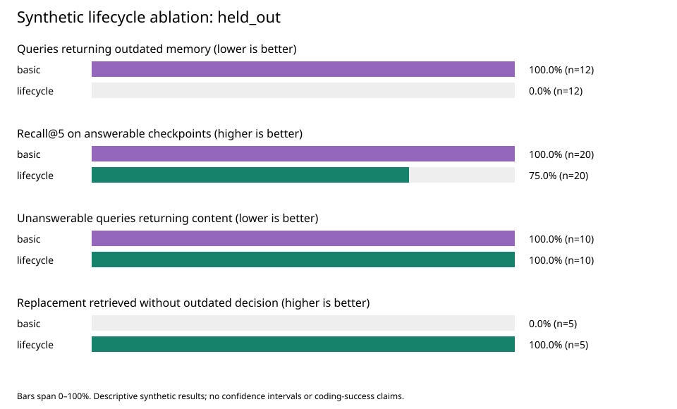

# Synthetic commit-aware retrieval experiment

Mode: **semantic_hybrid**. Dataset SHA-256: `3731d6d9cd33e33ff01af0e75c829441e501bf48b46bf8990e71a60ccd0336c9`.

Both variants use the same corpus, query, file hints, hybrid ranking, and semantic candidates.
Only `include_history` differs. Basic is a controlled ablation, not a reproduction of an older release.

| Partition/category | Variant | Checkpoints | Recall@k | MRR | Outdated hit | No-answer FP | Update correct |
| --- | --- | ---: | ---: | ---: | ---: | ---: | ---: |
| held_out/all | basic | 30 | 1.000 | 1.000 | 1.000 | 1.000 | 0.000 |
| held_out/all | lifecycle | 30 | 0.750 | 0.750 | 0.000 | 1.000 | 1.000 |
| held_out/changed | basic | 7 | N/A | N/A | 1.000 | 1.000 | N/A |
| held_out/changed | lifecycle | 7 | N/A | N/A | 0.000 | 1.000 | N/A |
| held_out/no_answer | basic | 3 | N/A | N/A | N/A | 1.000 | N/A |
| held_out/no_answer | lifecycle | 3 | N/A | N/A | N/A | 1.000 | N/A |
| held_out/superseded | basic | 5 | 1.000 | 1.000 | 1.000 | N/A | 0.000 |
| held_out/superseded | lifecycle | 5 | 1.000 | 1.000 | 0.000 | N/A | 1.000 |
| held_out/unrelated | basic | 5 | 1.000 | 1.000 | N/A | N/A | N/A |
| held_out/unrelated | lifecycle | 5 | 1.000 | 1.000 | N/A | N/A | N/A |
| held_out/valid | basic | 10 | 1.000 | 1.000 | N/A | N/A | N/A |
| held_out/valid | lifecycle | 10 | 0.500 | 0.500 | N/A | N/A | N/A |

## Interpretation and limitations

- Outdated means factually replaced according to fixture labels. Stale means unreviewed evidence; these differ.
- Valid-refactor scenarios have two checkpoints. Pending-review recall measures the cost of withholding a still-true memory; after-review measures recovery.
- Missing-answer cases include changed facts whose replacements have not been recorded and four unrelated questions. Category rows separate them.
- The semantic candidate stage returns nearest neighbors without an abstention threshold. Lifecycle filtering cannot by itself identify unrelated active memories.
- Denominators are stored beside every aggregate in summary.csv; N/A values are excluded, never counted as zero.
- Labels and review actions are authored fixtures, not automated truth verification or LLM extraction.
- Five development scenarios and 25 reserved scenarios were fixed before execution. This is not an independently authored, blinded, or real-world benchmark.
- Scenarios use small Python configuration files and six shared distractors. Category samples are small and templated; no significance or generalization claim is justified.
- No model answers, agent coding success, tokenizer usage, or performance/latency comparison is measured.
- Raw results preserve IDs, statuses, relevance labels, ranking reasons/scores, actual commits, diffs, and lifecycle events.

## Observed failures / tradeoffs

- basic: 15 checkpoints with at least one measured failure/tradeoff.
  - `s02-cache/after_observation`: `{"ineligible_hit": true, "no_answer_false_positive": true, "outdated_fraction": 0.2, "outdated_hit": true, "recall_at_k": null, "reciprocal_rank": null, "update_correct": null}`
  - `s03-auth/after_observation`: `{"ineligible_hit": true, "no_answer_false_positive": true, "outdated_fraction": 0.2, "outdated_hit": true, "recall_at_k": null, "reciprocal_rank": null, "update_correct": null}`
  - `s04-uploads/after_observation`: `{"ineligible_hit": true, "no_answer_false_positive": true, "outdated_fraction": 0.2, "outdated_hit": true, "recall_at_k": null, "reciprocal_rank": null, "update_correct": null}`
  - `s05-retry/after_observation`: `{"ineligible_hit": true, "no_answer_false_positive": true, "outdated_fraction": 0.2, "outdated_hit": true, "recall_at_k": null, "reciprocal_rank": null, "update_correct": null}`
  - `s06-dates/after_observation`: `{"ineligible_hit": true, "no_answer_false_positive": true, "outdated_fraction": 0.2, "outdated_hit": true, "recall_at_k": null, "reciprocal_rank": null, "update_correct": null}`
  - `s07-queue/after_observation`: `{"ineligible_hit": true, "no_answer_false_positive": true, "outdated_fraction": 0.2, "outdated_hit": true, "recall_at_k": null, "reciprocal_rank": null, "update_correct": null}`
  - `s08-search/after_observation`: `{"ineligible_hit": true, "no_answer_false_positive": true, "outdated_fraction": 0.2, "outdated_hit": true, "recall_at_k": null, "reciprocal_rank": null, "update_correct": null}`
  - `s22-logs/after_review`: `{"ineligible_hit": true, "no_answer_false_positive": null, "outdated_fraction": 0.2, "outdated_hit": true, "recall_at_k": 1.0, "reciprocal_rank": 1.0, "update_correct": false}`
  - `s23-pagination/after_review`: `{"ineligible_hit": true, "no_answer_false_positive": null, "outdated_fraction": 0.2, "outdated_hit": true, "recall_at_k": 1.0, "reciprocal_rank": 1.0, "update_correct": false}`
  - `s24-notifications/after_review`: `{"ineligible_hit": true, "no_answer_false_positive": null, "outdated_fraction": 0.2, "outdated_hit": true, "recall_at_k": 1.0, "reciprocal_rank": 1.0, "update_correct": false}`
  - `s25-backups/after_review`: `{"ineligible_hit": true, "no_answer_false_positive": null, "outdated_fraction": 0.2, "outdated_hit": true, "recall_at_k": 1.0, "reciprocal_rank": 1.0, "update_correct": false}`
  - `s26-compression/after_review`: `{"ineligible_hit": true, "no_answer_false_positive": null, "outdated_fraction": 0.2, "outdated_hit": true, "recall_at_k": 1.0, "reciprocal_rank": 1.0, "update_correct": false}`
  - `s28-theme/after_observation`: `{"ineligible_hit": null, "no_answer_false_positive": true, "outdated_fraction": 0.0, "outdated_hit": null, "recall_at_k": null, "reciprocal_rank": null, "update_correct": null}`
  - `s29-sorting/after_observation`: `{"ineligible_hit": null, "no_answer_false_positive": true, "outdated_fraction": 0.0, "outdated_hit": null, "recall_at_k": null, "reciprocal_rank": null, "update_correct": null}`
  - `s30-avatars/after_observation`: `{"ineligible_hit": null, "no_answer_false_positive": true, "outdated_fraction": 0.0, "outdated_hit": null, "recall_at_k": null, "reciprocal_rank": null, "update_correct": null}`
- lifecycle: 15 checkpoints with at least one measured failure/tradeoff.
  - `s02-cache/after_observation`: `{"ineligible_hit": false, "no_answer_false_positive": true, "outdated_fraction": 0.0, "outdated_hit": false, "recall_at_k": null, "reciprocal_rank": null, "update_correct": null}`
  - `s03-auth/after_observation`: `{"ineligible_hit": false, "no_answer_false_positive": true, "outdated_fraction": 0.0, "outdated_hit": false, "recall_at_k": null, "reciprocal_rank": null, "update_correct": null}`
  - `s04-uploads/after_observation`: `{"ineligible_hit": false, "no_answer_false_positive": true, "outdated_fraction": 0.0, "outdated_hit": false, "recall_at_k": null, "reciprocal_rank": null, "update_correct": null}`
  - `s05-retry/after_observation`: `{"ineligible_hit": false, "no_answer_false_positive": true, "outdated_fraction": 0.0, "outdated_hit": false, "recall_at_k": null, "reciprocal_rank": null, "update_correct": null}`
  - `s06-dates/after_observation`: `{"ineligible_hit": false, "no_answer_false_positive": true, "outdated_fraction": 0.0, "outdated_hit": false, "recall_at_k": null, "reciprocal_rank": null, "update_correct": null}`
  - `s07-queue/after_observation`: `{"ineligible_hit": false, "no_answer_false_positive": true, "outdated_fraction": 0.0, "outdated_hit": false, "recall_at_k": null, "reciprocal_rank": null, "update_correct": null}`
  - `s08-search/after_observation`: `{"ineligible_hit": false, "no_answer_false_positive": true, "outdated_fraction": 0.0, "outdated_hit": false, "recall_at_k": null, "reciprocal_rank": null, "update_correct": null}`
  - `s16-transport/pending_review`: `{"ineligible_hit": false, "no_answer_false_positive": null, "outdated_fraction": 0.0, "outdated_hit": null, "recall_at_k": 0.0, "reciprocal_rank": 0.0, "update_correct": null}`
  - `s17-audit/pending_review`: `{"ineligible_hit": false, "no_answer_false_positive": null, "outdated_fraction": 0.0, "outdated_hit": null, "recall_at_k": 0.0, "reciprocal_rank": 0.0, "update_correct": null}`
  - `s18-inventory/pending_review`: `{"ineligible_hit": false, "no_answer_false_positive": null, "outdated_fraction": 0.0, "outdated_hit": null, "recall_at_k": 0.0, "reciprocal_rank": 0.0, "update_correct": null}`
  - `s19-email/pending_review`: `{"ineligible_hit": false, "no_answer_false_positive": null, "outdated_fraction": 0.0, "outdated_hit": null, "recall_at_k": 0.0, "reciprocal_rank": 0.0, "update_correct": null}`
  - `s20-money/pending_review`: `{"ineligible_hit": false, "no_answer_false_positive": null, "outdated_fraction": 0.0, "outdated_hit": null, "recall_at_k": 0.0, "reciprocal_rank": 0.0, "update_correct": null}`
  - `s28-theme/after_observation`: `{"ineligible_hit": null, "no_answer_false_positive": true, "outdated_fraction": 0.0, "outdated_hit": null, "recall_at_k": null, "reciprocal_rank": null, "update_correct": null}`
  - `s29-sorting/after_observation`: `{"ineligible_hit": null, "no_answer_false_positive": true, "outdated_fraction": 0.0, "outdated_hit": null, "recall_at_k": null, "reciprocal_rank": null, "update_correct": null}`
  - `s30-avatars/after_observation`: `{"ineligible_hit": null, "no_answer_false_positive": true, "outdated_fraction": 0.0, "outdated_hit": null, "recall_at_k": null, "reciprocal_rank": null, "update_correct": null}`

## Charts

