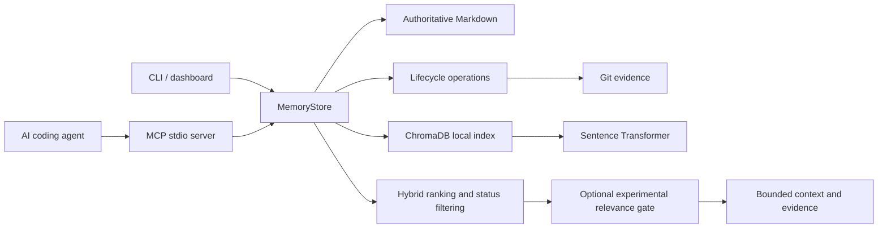

# 0xMemory: Commit-Aware Persistent Memory for AI Coding Agents

Technical report prepared from the implemented prototype and recorded experiments.
Team: Team 9. Add the institution's required author names, registration numbers,
supervisor, declarations, and formatting before academic submission. These details
were not supplied and are not invented here.

## Abstract

AI coding conversations can lose architectural decisions across sessions. Persistent
memory helps retain context, but retained decisions may become outdated when code
changes. This project extends 0xMemory with code-linked evidence, explicit Git commit
observation, active/stale/superseded states, reviewed verification and replacement,
and lifecycle-aware retrieval. Markdown remains the authoritative memory store;
ChromaDB supplies a rebuildable local semantic index. MCP exposes the system to
coding agents, with CLI and dashboard interfaces for inspection.

A developer-reported VS Code Copilot demonstration migrated a separate todo app
from JSON to SQLite and retrieved the updated decision in a fresh chat. A controlled
synthetic evaluation used 30 Git-backed scenarios, including five development and
25 reserved cases. In the reserved partition, lifecycle filtering reduced checkpoints
returning labelled outdated memories from 12/12 to 0/12. It temporarily withheld
five still-valid memories pending review, reducing Recall@5 over answerable
checkpoints from 100% to 75%; retrieval recovered after verification. A separate
24-case relevance experiment found that a calibrated cosine threshold did not
improve no-answer retrieval in its 16-case reserved partition. The gate remains
experimental and disabled by default. These results concern controlled retrieval,
not autonomous truth verification or improved coding-task success.

## 1. Problem and objectives

Project decisions include both implementation facts and rationale: why a storage
backend was chosen, what constraint applied, and which code revision supported the
choice. A new agent conversation may lack that rationale. Conversely, a saved
decision can survive long after its implementation has changed. Simply returning
the nearest memory is therefore insufficient.

The objectives are to preserve project-scoped decisions across sessions; attach
repository-relative files and commit evidence; flag potentially affected memories
after explicit observation; require review before confirming or replacing them;
preserve history; and retrieve current decisions through MCP. The evaluation asks
whether lifecycle filtering reduces outdated retrieval, what useful context it
withholds, and whether an additional relevance gate helps unanswered questions.

The project does not claim novelty for persistence, embeddings, or MCP themselves.
Its specific engineering contribution is their combination with an auditable,
commit-aware lifecycle and a controlled evaluation of its tradeoffs.

## 2. System architecture

Each application has its own `.0xmemory` directory. A single engine installation
can serve different projects by passing an explicit project root to `serve`.
Editors launch an MCP subprocess over stdin/stdout; the optional web application
and dashboard have separate HTTP ports. No cloud extraction key is needed for
remember/recall, although a hosted coding agent still uses its own account/network.

The main implementation modules are storage/memory_store.py, markdown.py,
vector_store.py, repository.py, lifecycle.py, retrieval.py, and relevance.py.
MCP tools are registered in mcp/server.py. CLI lifecycle commands are in
cli/lifecycle.py; the inspection interface is dashboard.py.

## 3. Memory and evidence model

Memories retain an ID, content, type, timestamps, importance, confidence,
repository-relative file paths, optional symbols, evidence commit, lifecycle
state, review note, revision history, and supersession relationships. Types include
facts, decisions, learnings, and preferences. Confidence is stored metadata, not
a calibrated probability of correctness.

Markdown contains the authoritative entries. Vector data can be rebuilt after
manual edits; metadata comments must be preserved. Updates replace the targeted
entry rather than corrupting neighbors. Exact duplicate suppression avoids repeated
identical content with matching evidence and metadata. Near-duplicate consolidation
and automatic contradiction classification are not implemented.

## 4. Lifecycle workflow

1. A caller saves a decision with supporting file paths and a commit SHA.
2. After a code change is committed, the caller explicitly invokes observation.
3. Git differences intersected with evidence paths identify affected memories.
4. Affected active memories become stale and require review; unrelated memories
   remain active. A change is not automatically classified as a contradiction.
5. If the statement remains true, verification records a note and current evidence.
6. If the decision changed, supersession creates an active replacement and keeps
   the previous entry and links in history.
7. Normal recall excludes stale/superseded entries; history can be inspected explicitly.

Evidence paths must exist at the review commit, and the commit must include the
latest known evidence change. The software checks paths and commit ordering; it
does not prove that natural-language claims follow from code. Observation is not a
background watcher, and uncommitted edits are not automatically tracked.

## 5. Retrieval and experimental abstention

The retriever combines keyword and semantic candidate ranks using reciprocal-rank
fusion, with additional file/symbol relevance signals. Lifecycle state determines
eligibility. Context includes memory IDs, evidence, ranking explanations, and a
budgeted string. UTF-8 byte length is used as a conservative budget proxy; actual
model tokens are not measured, and surrounding JSON metadata is outside that budget.

An experimental gate can additionally require cosine similarity above a threshold.
The implementation computes cosine from the actual embedding vectors and their
norms rather than interpreting fusion scores as confidence. Without embeddings,
it uses a conservative content-token overlap heuristic. File hints alone cannot
make a candidate pass. Empty context explains whether retrieval found no eligible
memory or the context budget excluded candidates.

The gate is disabled by default because the new reserved experiment did not show
better answerability. Topic similarity does not imply that a memory contains the
requested reason, owner, date, or contractual detail.

## 6. Demonstration in a separate application

The developer used VS Code Copilot Agent with testDodoapp. A JSON storage decision
was stored as `mem-746bf126`, linked to storage.py and commit
`ba7baeb5dd58e964fbcb038ec74cd067d859018f`. A different chat recalled the decision
and the supplied lab/prototype rationale. Copilot then implemented a SQLite migration
with one-time import and reported six passing app tests.

Commit `63549105ce9835c5213f789aab10e8aa94e18e40` was observed. The old decision
became stale, was reviewed, and was superseded by `mem-5a804a2f`. A later fresh chat
retrieved the SQLite decision and that evidence commit. These steps were reported
by the developer through pasted agent responses; exact IDE/model versions and raw
screenshots were not supplied. The record does not establish Cursor/Antigravity
UI operation, which remains a separate replication task.

## 7. Experiment A: lifecycle-filtering ablation

Thirty assistant-authored synthetic scenarios use actual temporary Git repositories,
two commits, stored evidence, observation, and the applicable review operation.
Categories are eight changed decisions, six unrelated changes, six valid linked-file
refactors, six reviewed replacements, and four no-answer cases. The first case in
each category is development; 25 remaining cases were reserved before execution.

Both variants use identical queries, corpora, hints, semantic candidate order,
fusion ranking, and k=5. Basic disables status filtering; lifecycle enables it.
This isolates eligibility rather than comparing two different search algorithms.
Each corpus has one initial decision and six distractors, plus a replacement where
appropriate. Valid-refactor scenarios have two correlated checkpoints.

| Reserved-partition measurement | Basic | Lifecycle |
| --- | ---: | ---: |
| Outdated-hit rate, 12 applicable checkpoints | 12/12 | 0/12 |
| Recall@5, 20 answerable checkpoints | 20/20 | 15/20 |
| MRR, same answerable checkpoints | 1.00 | 0.75 |
| Clean replacement retrieval, 5 cases | 0/5 | 5/5 |
| Unrelated-change preservation, 5 cases | 5/5 | 5/5 |
| No-answer false positives, 10 checkpoints | 10/10 | 10/10 |

The recall loss comes from five still-true decisions while their evidence awaits
review. All five are retrieved after verification. Labels remain based on fixture
truth instead of relabelling stale entries irrelevant. This exposes the tradeoff.

## 8. Experiment B: new relevance cases

Twenty-four new cases comprise eight development and 16 reserved questions, each
partition evenly split into answerable and unanswered cases. Memories are all
active. Development-only search evaluated cosine thresholds from 0.25 to 0.75,
minimizing twice the missed-answer rate plus the no-answer false-positive rate,
with lower-threshold tie breaking. The selected 0.25 threshold was frozen before
the reserved run.

Each corpus has only two or three entries and k=5, so ungated recall of the sole
answer is guaranteed by corpus size. This is an abstention/retention experiment,
not a large-corpus ranking benchmark.

| Measurement | Ungated | Gated |
| --- | ---: | ---: |
| Development answer recall | 4/4 | 4/4 |
| Development no-answer false positives | 4/4 | 2/4 |
| Reserved answer recall | 8/8 | 8/8 |
| Reserved no-answer false positives | 8/8 | 8/8 |
| Reserved false abstention on answerable cases | 0/8 | 0/8 |

The development improvement did not generalize. This negative result is retained,
not hidden by threshold tuning on the reserved cases. A stronger answerability
model and independently labelled hard negatives are future work.

## 9. Validation and reproducibility

The original normal-terminal installation passed 79 tests, including the native
MCP client launcher. Later evaluator and relevance tests extend that suite; see
INTEGRATION_STATUS.md for the current run and any environment exclusions. The
restricted tool session cannot use Windows overlapped named pipes, so its real MCP
SDK integration also has an ordinary-pipe transport test. That is distinct from
claiming the native launcher passed in the restricted session.

Raw JSON, CSV, dataset snapshots, source fingerprints, reports, and charts accompany
Experiment A. Experiment B retains its entire threshold grid, policy, candidate
cosines, labels, and result IDs. Failures stop semantic evaluation rather than
silently turning it into keyword-only retrieval. Outputs are preserved in fresh
directories. START_HERE.md provides an independent clone-to-demo procedure.

## 10. Limitations and future work

- All experiment labels are synthetic and assistant-authored; human review is pending.
- Corpora are small; no statistical significance or generalization claim is made.
- Reviews and evidence links are supplied, not inferred autonomously.
- Observation is explicit, and multiple concurrent writer processes are unsupported.
- Unlinked memories, uncommitted changes, and renames need further handling/testing.
- The relevance gate does not solve answer entailment and remains opt-in.
- No controlled coding-task success, productivity, model-token, or latency study was run.
- Independent teammate reproduction and additional editor UI tests remain open.

The next research phase should use human-labelled questions from real repository
histories, assess review/extraction quality, and compare agent coding tasks under
matched models, budgets, and code revisions. Any relevance redesign needs another
reserved dataset because both current test sets have now been inspected.

## Conclusion

The prototype implements persistent, auditable project decisions with explicit
code-change observation and review. The recorded case study and controlled fixtures
support its intended lifecycle behavior while exposing verification-delay and
answerability limitations. The system is a working final-year prototype with
documented evidence, not a claim of universally reliable autonomous memory.

## References and supporting artifacts

- [MCP specification](https://modelcontextprotocol.io/specification/2025-11-25)
- [Sentence Transformers similarity documentation](https://sbert.net/docs/sentence_transformer/usage/semantic_textual_similarity.html)
- [Chroma documentation](https://docs.trychroma.com/)
- [Original developer demo](../DEMO_RESULTS.md)
- [Lifecycle methodology](../evaluation/README.md) and [findings](../evaluation/FINDINGS.md)
- [Relevance experiment](../evaluation/relevance/README.md)
- [Independent setup](../START_HERE.md) and [test report template](../TEST_REPORT_TEMPLATE.md)
